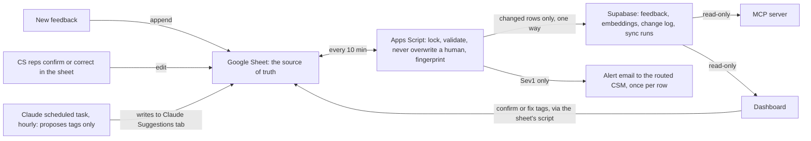

# CaseCompanion feedback pipeline

A small, self-updating system that turns raw CaseCompanion customer feedback into something anyone at EvenUp can use. New feedback lands in a Google Sheet, Claude proposes tags for it every hour, code checks those tags before they land, people confirm or correct them, and the clean data syncs to Supabase. From there anyone can ask questions from their own Claude, browse and review on a dashboard, or get an email when something serious comes in.

Built in three days as a take-home for EvenUp. It is a working proof of concept over mock data, not a product.

## Try it

| What | Where |
| --- | --- |
| Walkthrough video (3 min) | VIDEO_LINK |
| Dashboard | https://drosenbaum1794.github.io/casecompanion-feedback/ |
| Live sheet (view only) | https://docs.google.com/spreadsheets/d/1_PnSRLN4Bi822kcznqTyRuQ5gM9zU-3ot0EOjvIbROw/edit |
| Ask from your own Claude | Add `https://rienopvbkpukefaeynhb.supabase.co/functions/v1/feedback-mcp` as a custom connector (no sign-in), then try the prompts below |
| **Part 1:** insights memo | [docs/part1-insights.md](docs/part1-insights.md) |
| **Part 2:** process write-up (scoping, prompting, eval, tests) | [docs/process-writeup.md](docs/process-writeup.md) |
| **Part 3:** roadmap | [docs/part3-roadmap.md](docs/part3-roadmap.md) |
| Prompt versions and eval scores | [docs/prompt-log.md](docs/prompt-log.md) |
| Design decisions, as they were made | [docs/decisions.md](docs/decisions.md) |
| Test results | [docs/test-results.md](docs/test-results.md) |

**On the dashboard:** a health banner, top issues grouped by distinct issue, every Sev1 with its alert and follow-up status, segments against a baseline, weekly trends, and a review queue that puts Sev1s and flagged rows first. Filters carry across tabs and can be shared as a link. Any view exports to CSV. Reviewers can confirm or fix tags right there: the change is written to the sheet, then synced, in a few seconds.

**Starter prompts for the connector:**

1. What are the top 3 themes by distinct issues, and are they rising or falling?
2. Show me every Sev1, which segments they came from, and whether anyone followed up.
3. What do large-firm attorneys complain about that small firms don't?
4. Find feedback about medical record accuracy and summarize it with quotes.
5. Pull 3 strong wins about time saved for a QBR.

## How it works

**The rules the build follows:**

- **The agent proposes, code decides.** Claude only appends to a staging tab. Apps Script validates every value against the Taxonomy tab before anything reaches the Feedback tab.
- **Never overwrite a human.** The apply step re-reads each cell just before writing and fills only empty cells. A human edit always wins.
- **Numbers come from SQL, not the model.** Claude tags and explains. Counts, rankings, and trends come from database functions shared by the MCP server and the dashboard.
- **The sheet is the source of truth.** People edit the sheet directly or through the dashboard, which writes to the sheet and refuses if the row changed since the page loaded. Data flows one way into Supabase, which has a single writer.
- **Fail loudly.** Every sync is logged to the sheet's Health tab and to Supabase. Failures, a stalled tagger, and a tripped delete guard send email.

**What happens to a new row:** the next sync gives it an ID. The hourly tagging task proposes tags. The next sync validates and applies them, sends an alert if it's Sev1, and pushes the row to Supabase with an embedding. It shows up on the dashboard and in the MCP within about an hour, or within a minute or two using "Sync now" and "Run now."

## Accuracy, honestly

On a 40-row eval set, hand-labeled blind and then adjudicated against the written taxonomy, the production tagger (Haiku, prompt v2) caught **7 of 7 Sev1s** with 1 false alarm, and matched all four tags on **26 of 40** rows. Against the original blind labels, before adjudication, it matched 11 of 38. The gap is mostly label disagreement, which the prompt log explains. Self-reported confidence turned out not to be a useful signal. The eval set was deliberately weighted toward hard cases. Full method and every version: [docs/prompt-log.md](docs/prompt-log.md).

## What is demo-only

| Demo | Production would use |
| --- | --- |
| Tagging runs as a scheduled task on a personal Claude account | A direct API call from a service account with schema-enforced output. Only that one step changes, because the agent already writes only to a staging tab. |
| No sign-in on the dashboard or MCP, over mock data. Anyone with the dashboard link can confirm or fix tags (only taxonomy values, rate-limited, with an off switch in the sheet menu). | Google sign-in with an EvenUp-only allowlist, so every edit is tied to a person |
| Alerts route by firm size to mock CSMs (all to one inbox) | Real account and CSM data from the CRM |
| One alert channel (email) | Slack plus email |
| Sync runs as the sheet owner | A service account, so any editor can trigger it |

## Repo layout

| Path | What |
| --- | --- |
| `apps-script/` | The sheet's code: sync, apply, alerts, edit handler, and the web app behind "Open row" and dashboard review. Pushed with `clasp`. |
| `supabase/migrations/` | Tables, change-log trigger, read functions, security |
| `supabase/functions/ingest/` | The only writer to the database |
| `supabase/functions/feedback-mcp/` | Read-only MCP server |
| `dashboard/index.html` | The dashboard, one static file |
| `prompts/` | Every version of the tagging prompt |
| `scripts/` | Eval scoring, logic tests for the sheet code, memo numbers |
| `docs/` | Goals, scope, decisions, prompt log, test results, memo |

Run the sheet-logic tests with `node scripts/test-apps-script.mjs`. Score a prompt run with `node scripts/eval-score.mjs v2` (needs the gitignored `data/` folder).
